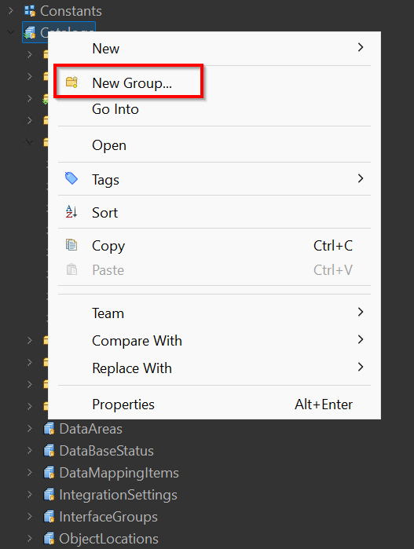
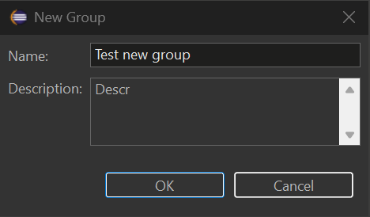
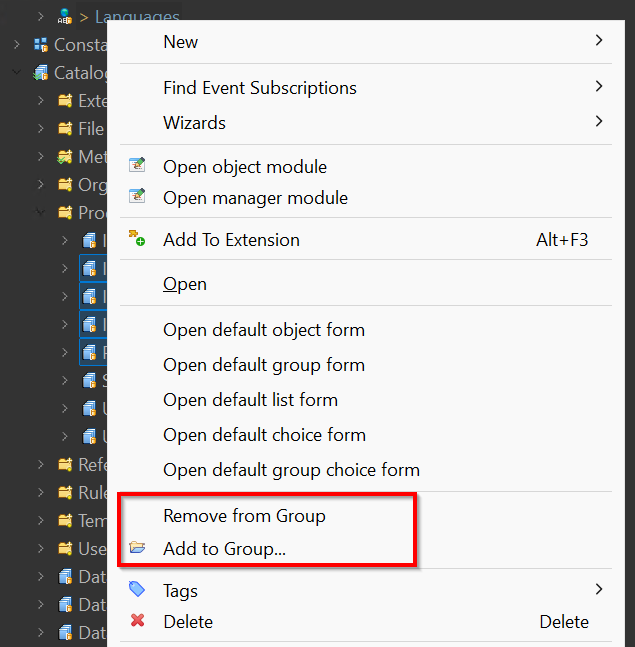
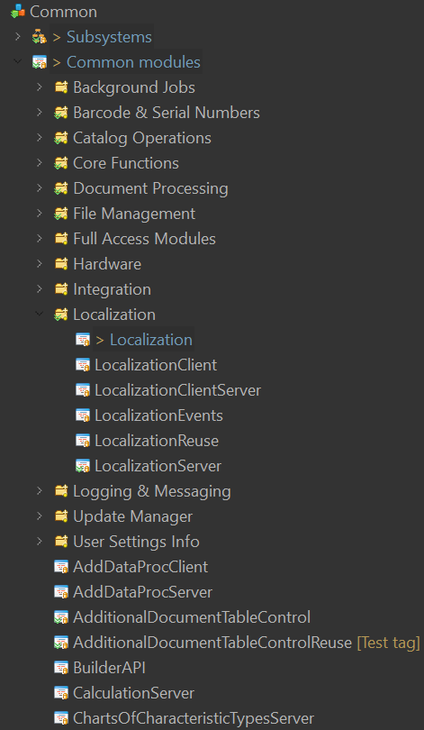
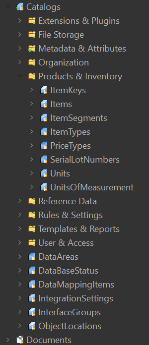

# Metadata Groups

Organize your Navigator tree with custom groups to create a logical folder structure for metadata objects.

## Why Use Groups?

Groups help you:
- Create custom folder hierarchy in the Navigator tree
- Organize objects by business area, feature, or any logical structure
- Navigate large configurations faster with nested groups
- Separate grouped objects from ungrouped ones

## Getting Started

**Creating a Group:**

1. Right-click on any metadata folder (e.g., Catalogs, Common modules) in the Navigator
2. Select **New Group...** from the context menu
3. Enter the group name and optional description
4. Click **OK** to create the group



**Create Group Dialog:**



**Adding Objects to a Group:**

1. Right-click on any metadata object in the Navigator
2. Select **Add to Group...**
3. Choose the target group from the list



**Removing Objects from a Group:**

1. Right-click on an object inside a group
2. Select **Remove from Group**

## Viewing Groups in Navigator

Grouped objects appear inside their group folders in the Navigator tree:





**Key Features:**
- Groups are created per metadata collection (Catalogs, Common modules, Documents, etc.)
- Objects inside groups are still accessible via standard EDT navigation
- Ungrouped objects appear at the end of the list
- Use the **Hide Groups** toggle button in the Navigator toolbar to temporarily hide virtual group folders and show grouped objects in their original collections again

## Group Operations

| Action | How to Do It |
|--------|--------------|
| Create group | Right-click folder → **New Group...** |
| Add object to group | Right-click object → **Add to Group...** |
| Remove from group | Right-click object in group → **Remove from Group** |
| Copy group name | Select group → **Ctrl+C** |
| Delete group | Right-click group → **Delete** |
| Rename group | Right-click group → **Rename...** |
| Hide/show groups | Click **Hide Groups** in the Navigator toolbar |

## Where Groups Are Stored

Groups are stored in `.settings/groups.yaml` file in each project. This file:
- Can be committed to version control (VCS friendly)
- Uses YAML format for easy readability
- Is automatically updated when you rename or delete objects

**Example:**
```yaml
groups:
- name: "Products & Inventory"
  description: "Product and inventory catalogs"
  path: Catalog
  order: 0
  children:
    - Catalog.ItemKeys
    - Catalog.Items
    - Catalog.ItemSegments
    - Catalog.Units
    - Catalog.UnitsOfMeasurement
- name: "Organization"
  description: "Organization structure catalogs"
  path: Catalog
  order: 1
  children:
    - Catalog.Companies
    - Catalog.Stores
- name: "Core Functions"
  description: "Core shared functions used across the application"
  path: CommonModule
  order: 0
  children:
    - CommonModule.CommonFunctionsClient
    - CommonModule.CommonFunctionsServer
    - CommonModule.CommonFunctionsClientServer
- name: "Localization"
  description: "Multi-language support modules"
  path: CommonModule
  order: 1
  children:
    - CommonModule.Localization
    - CommonModule.LocalizationClient
    - CommonModule.LocalizationServer
    - CommonModule.LocalizationReuse
```

