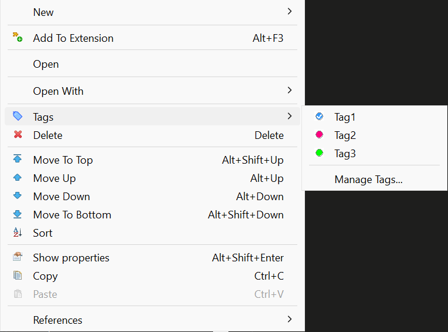
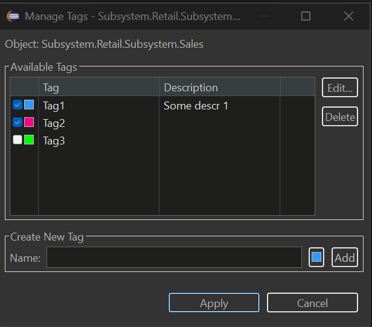
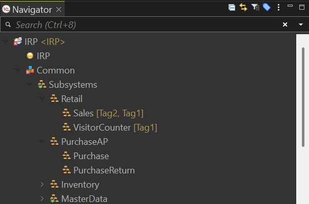
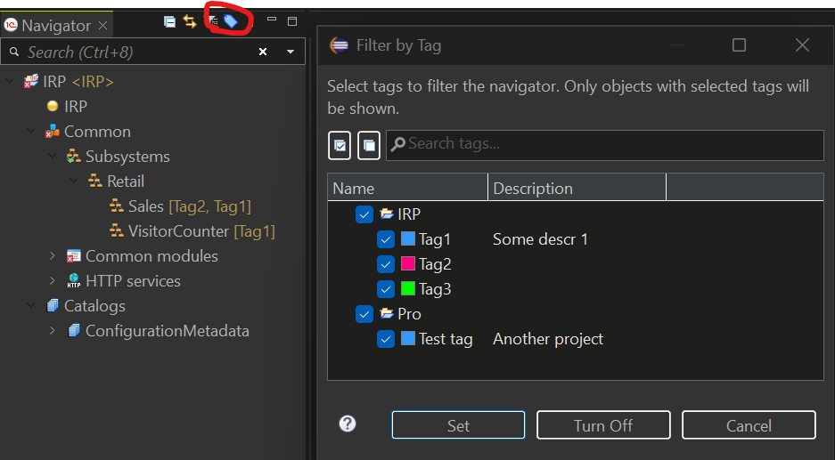

# Metadata Tags

Organize your metadata objects with custom tags for easier navigation and filtering.

## Why Use Tags?

Tags help you:
- Group related objects across different metadata types (e.g., all objects for a specific feature)
- Quickly find objects in large configurations
- Filter the Navigator to focus on specific areas of the project
- Share object organization with your team via version control

## Getting Started

**Assigning Tags to Objects:**

1. Right-click on any metadata object in the Navigator
2. Select **Tags** from the context menu
3. Check the tags you want to assign, or select **Manage Tags...** to create new ones



**Managing Tags:**

In the Manage Tags dialog you can:
- Create new tags with custom names, colors, and descriptions
- Edit existing tags (name, color, description)
- Delete tags
- See all available tags for the project



## Viewing Tags in Navigator

Tagged objects show their tags as a suffix in the Navigator tree:



**To enable/disable tag display:**
- **Window → Preferences → General → Appearance → Label Decorations**
- Toggle "Metadata Tags Decorator"

## Filtering Navigator by Tags

Filter the entire Navigator to show only objects with specific tags:

1. Click the tag filter button in the Navigator toolbar (or right-click → **Tags → Filter by Tag...**)
2. Select one or more tags
3. Click **Set** to apply the filter



The Navigator will show only:
- Objects that have ANY of the selected tags
- Parent folders containing matching objects

**To clear the filter:** Click **Turn Off** in the dialog or use the toolbar button again.

## Keyboard Shortcuts for Tags

Quickly toggle tags on selected objects using keyboard shortcuts:

| Shortcut | Action |
|----------|--------|
| **Ctrl+Alt+1** | Toggle 1st tag |
| **Ctrl+Alt+2** | Toggle 2nd tag |
| **...** | ... |
| **Ctrl+Alt+9** | Toggle 9th tag |
| **Ctrl+Alt+0** | Toggle 10th tag |

**Features:**
- Works with multiple selected objects
- Supports cross-project selection (each object uses tags from its own project)
- Pressing the same shortcut again removes the tag (toggle behavior)
- Tag order is configurable in the Manage Tags dialog (Move Up/Move Down buttons)

**To customize shortcuts:** Window → Preferences → General → Keys → search for "Toggle Tag"

## Filtering Untagged Objects

Find metadata objects that haven't been tagged yet:

1. Open Filter by Tag dialog (toolbar button or Tags → Filter by Tag...)
2. Check the **"Show untagged objects only"** checkbox
3. Click **Set**

The Navigator will show only objects that have no tags assigned, making it easy to identify objects that need categorization.

## Multi-Select Tag Assignment

Assign or remove tags from multiple objects at once:

1. Select multiple objects in the Navigator (Ctrl+Click or Shift+Click)
2. Right-click → **Tags**
3. Select a tag to toggle it on/off for ALL selected objects

**Behavior:**
- ✓ Checked = all selected objects have this tag
- ☐ Unchecked = none of the selected objects have this tag
- When objects are from different projects, only objects from projects that have the tag will be affected

## Tag Filter View

For advanced filtering across multiple projects, use the Tag Filter View:

**Window → Show View → Other → MCP Server → Tag Filter**

This view provides:
- **Left panel**: Select tags from all projects in your workspace
- **Right panel**: See all matching objects with search and navigation
- **Search**: Filter results by object name using regex
- **Double-click**: Navigate directly to the object

## Where Tags Are Stored

Tags are stored in `.settings/metadata-tags.yaml` file in each project. This file:
- Can be committed to version control (VCS friendly)
- Is automatically updated when you rename or delete objects
- Uses YAML format for easy readability

**Example:**
```yaml
assignments:
  CommonModule.Utils:
    - Utils
  Document.SalesOrder:
    - Important
    - Sales
tags:
  - color: '#FF0000'
    description: Critical business logic
    name: Important
  - color: '#00FF00'
    description: ''
    name: Utils
  - color: '#0066FF'
    description: Sales department documents
    name: Sales
```

