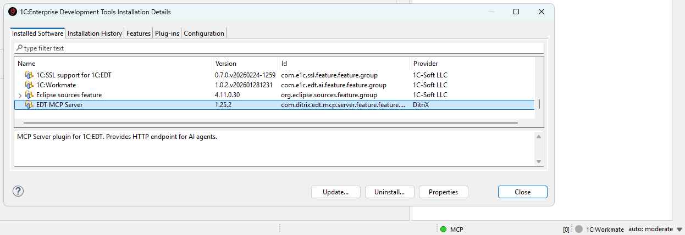
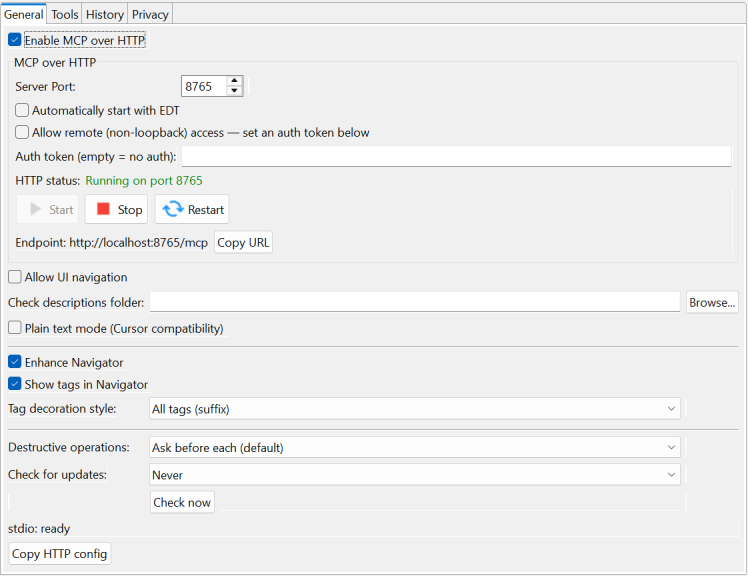
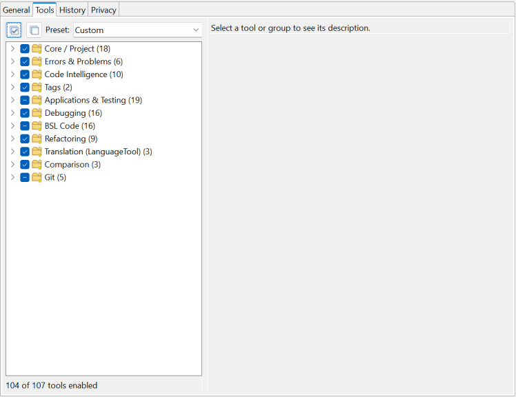
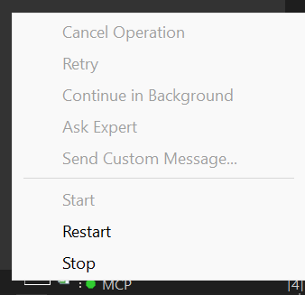

# Installation

## From Update Site

1. In EDT: **Help → Install New Software...**
2. Add update site URL: `https://ditrixnew.github.io/EDT-MCP/`
3. Select **EDT MCP Server Feature**
4. Restart EDT

## From Windows command line</strong> - "one shot" very fast install

Close your EDT (!) and run:

```bash
rem Here  "%VER_EDT% = 2025.2.3+30"  just for example - please, set YOUR actual version !
set VER_EDT=2025.2.3+30

"\your\path\to\EDT\components\1c-edt-%VER_EDT%-x86_64\1cedt.exe" -nosplash ^
    -application org.eclipse.equinox.p2.director ^
    -repository https://ditrixnew.github.io/EDT-MCP/ ^
	-installIU com.ditrix.edt.mcp.server.feature.feature.group ^
	-profileProperties org.eclipse.update.reconcile=true
```

## Installation Result

<details>
Once the installation has been completed successfully, we will see the following:


</details>

After that, EDT will automatically monitor the update site and install available updates when detected.

As well, we can also manually check via **Help → About → Installation Details → Select MCP → Update**

## Required JVM flag for form screenshots

**ATTENTION:** `get_form_screenshot` is **disabled by default**. Enable it in
**Window > Preferences > MCP Server > Tools**. On **Windows**, it works only when EDT starts
with this option after `-vmargs` in `1cedt.ini`:

```
-DnativeFormBufferedLayoutRender=true
```

`get_form_layout_snapshot` does not need this flag. Linux and macOS already use buffered native rendering, so the flag changes nothing there.

On Windows, with this flag, EDT's own form designer shows a **grey rectangle instead of the form** for the **whole session**. This is EDT behaviour. Changing the flag requires an **EDT restart**. EDT builds the buffer path as `<java.io.tmpdir>dtgraphics-form.bin`, without inserting a separator; if EDT cannot create that file, screenshots fail. Even with a usable buffer path, this mode can distort the designer on a scaled display: elements are drawn larger, and a click in the designer selects a different element in the element tree. Add the flag only while you need form screenshots, and remove it for everyday designer work.

**How to add it:**

1. Close EDT.
2. Open `1cedt.ini` (next to `1cedt.exe`, e.g. `C:\Program Files\1C\1CE\components\1c-edt-2025.2.6+4-x86_64\1cedt.ini`).
3. After the `-vmargs` line, add:

   ```
   -DnativeFormBufferedLayoutRender=true
   ```
4. Start EDT.

**How to add it (one-shot, no install changes):**

```cmd
"<path-to-EDT>\1cedt.exe" -data "<workspace>" -vmargs -DnativeFormBufferedLayoutRender=true
```

If a screenshot is blank or gray, check the EDT log for `AccessDeniedException` on `dtgraphics-form.bin`. A typical cause is `-Djava.io.tmpdir=C:\edt_tmp` without a trailing separator: EDT tries `C:\edt_tmpdtgraphics-form.bin`. Change the line to `-Djava.io.tmpdir=C:\edt_tmp\` and fully restart EDT. Also verify that `-vmargs` precedes the JVM options. If nothing helps, remove the buffered-render flag and restart EDT.

## Configuration

Go to **Window → Preferences → MCP Server**. The settings page has General, Tools, History and Privacy tabs:

> [!NOTE]
> **Display language.** The settings page and the tag dialogs are bilingual (Russian / English) and follow the Eclipse/EDT display language — the same `-nl` launch argument (or OS locale) that localizes the rest of EDT. Launch EDT with `-nl ru` for Russian or `-nl en` for English; any other locale falls back to English. The MCP tool surface itself (tool names, descriptions and errors) stays English regardless, as it is the AI wire contract.

### General Tab

- **Enable MCP over HTTP**: On by default. The **MCP over HTTP** group contains the port (default: 8765), auto-start, remote access, auth token, HTTP status, Start/Stop/Restart, endpoint and **Copy URL**. Clearing the checkbox hides these controls; Apply stops HTTP. Enabling it and applying starts HTTP only when auto-start is selected; otherwise use Start. No EDT restart is needed. IPC remains independent.
- **Check descriptions folder**: Optional override for the check descriptions that ship with the plugin. Leave it empty to use the bundled ones; point it at a folder to replace or translate individual checks (a file found there wins, per check)
- **Auto-start** (HTTP group): Start HTTP on EDT launch when HTTP is enabled. `EDT_MCP_AUTO_START=true` overrides both saved switches for CI; a launch with `-Dedt.mcp.stdioOnly=true` still suppresses HTTP auto-start without changing preferences.
- **Plain text mode (Cursor compatibility)**: Applies to every transport and stays visible when HTTP is off. Returns results as plain text instead of embedded resources (for AI clients that don't support MCP resources)
- **Enhance Navigator**: Controls this plugin’s contributions to the Navigator tree (groups and their filter). Turn it off to resolve conflicts with another plugin that patches the same panel
- **Show tags in Navigator**: Display tags as decorations in the Navigator tree
- **Tag decoration style**: How tags are displayed — all tags as suffix, first tag only, or tag count
- **Connection configuration**: One button outside the HTTP group reads **Copy HTTP config** or **Copy stdio .mcp.json**. It switches immediately with the checkbox: HTTP off selects stdio; a stdio-only launch also selects stdio while HTTP is stopped; otherwise it selects HTTP. The HTTP entry uses the running port (or the pending port when stopped) and the saved auth token, never an unsaved token. It uses the `mcpServers` + `type`/`url` shape (Cursor, VS Code, Claude Code); **Cline**, **Antigravity** and **OpenCode** need the shapes below. A saved token is included as an `Authorization` header, so treat the copied text as a secret.
- **Transport status**: An always-visible **stdio: ready/unavailable** line reports the local IPC listener, matching `get_server_status.transports.ipc`. HTTP status stays inside its group. A stdio-only launch shows a note there while HTTP is stopped. The status-bar indicator is green when either listener is serving, and its tooltip reports both transports. Restore Defaults re-enables and reveals HTTP without saving until Apply.



### Tools Tab

Manage which tools are available to AI assistants. Tools are organized into groups that can be enabled or disabled together. See [Tool Management](tool-management.md#tool-management) for details.



# Status Bar Controls

The MCP server status bar shows real-time execution status with interactive controls.

**Status Indicator:**
- 🟢 **Green** - Server running, idle
- 🟡 **Yellow blinking** - Tool is executing
- ⚪ **Grey** - Server stopped



<details>
<summary><strong>User Signal Controls</strong> - Send signals to AI agent during tool execution</summary>

**During Tool Execution:**
- Shows tool name (e.g., `MCP: update_database`)
- Shows elapsed time in MM:SS format
- Click to access control menu

When a tool is executing, you can send signals to the AI agent to interrupt the MCP call:

The status bar targets the latest registered call. An older overlapping call cannot clear
that slot when it finishes; after the latest call ends, older calls are not restored.

| Button | Description | When to Use |
|--------|-------------|-------------|
| **Cancel Operation** | Stops the MCP call and notifies agent | When you want to cancel a long-running operation |
| **Retry** | Tells agent to retry the operation | When an EDT error occurred and you want to try again |
| **Continue in Background** | Notifies agent the operation is long-running | When you want agent to check status periodically |
| **Ask Expert** | Stops and asks agent to consult with you | When you need to provide guidance |
| **Send Custom Message...** | Send a custom message to agent | For any custom instruction |

**How it works:**
1. When you click a button, a dialog appears showing the message that will be sent to the agent
2. You can edit the message before sending
3. The MCP call is immediately interrupted and returns control to the agent
4. The EDT operation continues running in the background
5. Agent receives a response like:
```
USER SIGNAL: Your message here

Signal Type: CANCEL
Tool: update_database
Elapsed: 20s

Note: The EDT operation may still be running in background.
```

**Use cases:**
- Long-running operations (full database update, project validation) blocking the agent
- Need to give the agent additional instructions
- EDT showed an error dialog and you want agent to retry
- Want to switch agent's focus to a different task

</details>

