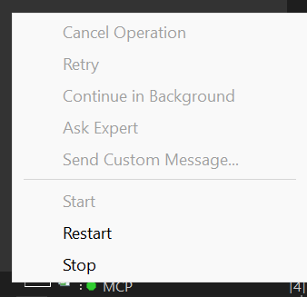

# Status Bar Controls

The MCP server status bar shows real-time execution status with interactive controls.

**Status Indicator:**
- 🟢 **Green** - Server running, idle
- 🟡 **Yellow blinking** - Tool is executing
- ⚪ **Grey** - Server stopped



<details>
<summary><strong>User Signal Controls</strong> - Send signals to AI agent during tool execution</summary>

**During Tool Execution:**
- Shows tool name (e.g., `MCP: update_database`)
- Shows elapsed time in MM:SS format
- Click to access control menu

When a tool is executing, you can send signals to the AI agent to interrupt the MCP call:

The status bar targets the latest registered call. An older overlapping call cannot clear
that slot when it finishes; after the latest call ends, older calls are not restored.

| Button | Description | When to Use |
|--------|-------------|-------------|
| **Cancel Operation** | Stops the MCP call and notifies agent | When you want to cancel a long-running operation |
| **Retry** | Tells agent to retry the operation | When an EDT error occurred and you want to try again |
| **Continue in Background** | Notifies agent the operation is long-running | When you want agent to check status periodically |
| **Ask Expert** | Stops and asks agent to consult with you | When you need to provide guidance |
| **Send Custom Message...** | Send a custom message to agent | For any custom instruction |

**How it works:**
1. When you click a button, a dialog appears showing the message that will be sent to the agent
2. You can edit the message before sending
3. The MCP call is immediately interrupted and returns control to the agent
4. The EDT operation continues running in the background
5. Agent receives a response like:
```
USER SIGNAL: Your message here

Signal Type: CANCEL
Tool: update_database
Elapsed: 20s

Note: The EDT operation may still be running in background.
```

**Use cases:**
- Long-running operations (full database update, project validation) blocking the agent
- Need to give the agent additional instructions
- EDT showed an error dialog and you want agent to retry
- Want to switch agent's focus to a different task

</details>

